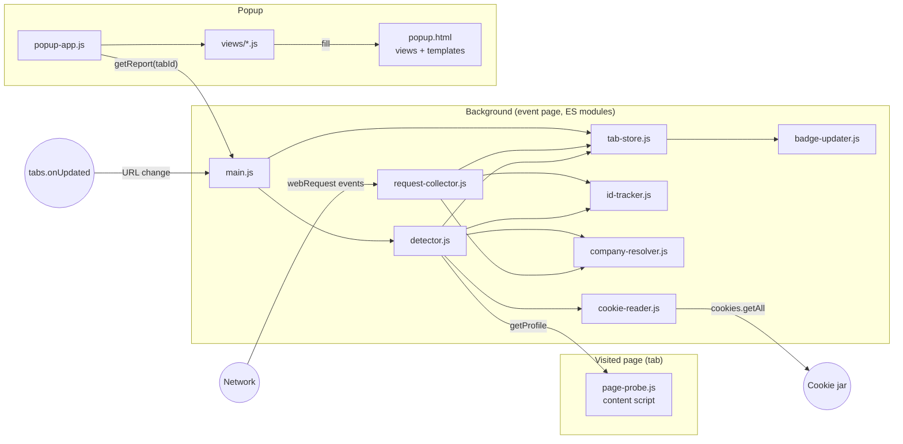

# Architecture

kd-onlooker is a Firefox extension (Manifest V3) that passively observes the requests a page sends to third parties and explains in plain language what each recipient learns about the user. It never blocks, modifies or sends anything.

## Principles

- Read-only: `webRequest` listeners without `"blocking"`.
- Local only: all data stays in `browser.storage`, no network access of its own.
- No dependencies: vanilla JavaScript and plain CSS. The popup uses the Karnes Development colors as CSS custom properties and Tabler icons as SVG files. Running, linting and packaging use the globally installed `web-ext` (`web-ext run`, `web-ext lint --ignore-files docs tests`, `web-ext build --ignore-files docs tests`); tests run with `node --test`.
- Separation of concerns: markup lives in HTML, styles in CSS, JavaScript only selects elements, fills them and toggles their visibility. JavaScript never builds markup.
- Plain ES modules with exported functions; module state lives in module-level variables. No classes.
- UI in English and German through `_locales/` and `browser.i18n`. Code, comments and docs in English.

## Components



| Module                            | Responsibility                                                                                                                                                                                                                                                     |
|-----------------------------------|--------------------------------------------------------------------------------------------------------------------------------------------------------------------------------------------------------------------------------------------------------------------|
| `content/page-probe.js`           | Answers `getProfile` with the current values the page could leak: title, screen size, language, time zone.                                                                                                                                                       |
| `background/main.js`              | Entry point. Registers the webRequest, message, tab and suspend listeners and routes messages.                                                                                                                                                                    |
| `background/request-collector.js` | Handles `webRequest.onBeforeRequest` (with `requestBody`) and `onSendHeaders` (with `requestHeaders`). Keeps only requests where `details.thirdParty` is `true` and `tabId >= 0`, parses parameters and cookies, hashes ID candidates and records them for the site of the request's top-level document. |
| `background/tab-store.js`         | Holds per-tab state in `storage.session`: the page URL and the collected third-party requests. Resets on top-level navigation and on URL changes without one, drops requests of other sites, deletes on tab close.                                               |
| `background/detector.js`          | Requests the page profile from the content script, evaluates the stored requests of a tab against it and produces the report shown in the popup.                                                                                                                 |
| `background/id-tracker.js`        | Persists hashed identifier sightings in `storage.local` to recognise the same ID across different sites.                                                                                                                                                          |
| `background/company-resolver.js`  | Maps hosts to company names using the bundled `companies.json`. Unknown hosts stay as they are.                                                                                                                                                                   |
| `background/cookie-reader.js`     | Reads the cookies of a recipient's domains live from the cookie jar when a report is built, keeps the ones that were actually sent and splits their values into readable parts. Cookie values are never stored.                                                  |
| `background/badge-updater.js`     | Shows the number of recipients on the toolbar icon of a tab.                                                                                                                                                                                                      |
| `popup/popup-app.js`              | Entry point of the popup. Checks tab and permission, requests the report and switches between the views.                                                                                                                                                          |
| `popup/views/*.js`                | One module per view. Fills the view's section in `popup.html` and the cloned templates with report data.                                                                                                                                                          |

## Firefox APIs

| API                          | Use                                                                                                    |
|------------------------------|--------------------------------------------------------------------------------------------------------|
| `webRequest.onBeforeRequest` | URL, method, body (`"requestBody"`), `thirdParty`, `tabId`, `type`, `timeStamp`, `documentUrl`, `frameAncestors`, `incognito` |
| `webRequest.onSendHeaders`   | Request headers (`"requestHeaders"`), including `Cookie` and `Referer`                                 |
| `storage.session`            | Per-tab state, survives event page suspension, cleared on browser restart (quota 10 MiB)               |
| `storage.local`              | Hashed ID sightings and the salt for site hashes                                                       |
| `cookies`                    | Read-only: cookies of the recipients, including partitioned cookies (`partitionKey`)                   |
| `tabs`                       | URL changes, close events, active tab, reload and the `getProfile` message to the content script       |
| `action`                     | Badge text and colour, theme-dependent icon                                                            |
| `i18n`                       | English and German UI strings                                                                          |
| `permissions`                | Checks the host permission in the popup                                                                |
| `runtime`                    | Messaging between popup and background, `onSuspend` to write pending state                             |

`details.thirdParty` is provided by Firefox itself, so no public suffix list is needed to decide what counts as a third party.

## Permissions

```json
{
  "permissions": ["webRequest", "storage", "cookies"],
  "host_permissions": ["<all_urls>"]
}
```

`browser_specific_settings.gecko.data_collection_permissions.required` is set to `["none"]`, which AMO has required for new extensions since November 3, 2025 (Firefox 140+, Android 142+).

The `cookies` permission together with the host permissions allows reading all cookies, including `secure` ones. The extension only reads them.

The host permission also exposes `tab.url` and `changeInfo.url` of web pages, so the `tabs` permission is not needed.

Since Firefox 127, the host permission has been requested at installation time. The user can revoke it in `about:addons`, so the popup checks it with `permissions.contains` and shows a hint when it is missing.

## Private windows

In private windows, requests are collected into `storage.session` like in normal windows, but no ID sightings are written to `storage.local`.

## Popup rendering

- `popup.html` contains every view as `<section data-view="<name>" hidden>` with its complete markup, and every repeated item as a `<template>`.
- Elements that receive data carry `data-field="<name>"`; containers for repeated items carry `data-list="<name>"`. A field lookup skips fields inside nested lists.
- Static texts carry `data-i18n="<message key>"` (text) or `data-i18n-label="<message key>"` (`aria-label`) and are filled once on start.
- Icons are Tabler SVG files in `assets/icons/<name>.svg`, each with `id="icon"` on its root `<svg>`. The markup references them as `<svg class="icon" viewBox="0 0 24 24"><use href="../assets/icons/<name>.svg#icon" /></svg>`, so they take the text colour (`currentColor`) and the size of the `.icon` classes. Where the icon depends on data, the view only sets the `href` of the `<use>`.
- Expanded request and cookie items rotate their chevron with CSS.
- The tabs of the technical view follow the ARIA tab pattern: `aria-controls`, `aria-selected`, only the selected tab in the tab order, arrow keys switch tabs.
- Views show their section, fill fields with `textContent`, clone templates for lists and set handlers on existing buttons.
- `popup/dom.js` holds the shared helpers: show a view, find a field, set a text, clone a template, apply the static texts, set an icon.

## Project structure

```
kd-onlooker/
├── manifest.json
├── _locales/
│   ├── en/messages.json
│   └── de/messages.json
├── assets/
│   ├── logo-on-dark.svg
│   ├── logo-on-light.svg
│   └── icons/
│       ├── arrow-left.svg
│       ├── chevron-down.svg
│       ├── chevron-right.svg
│       ├── clock.svg
│       ├── cookie.svg
│       ├── device-desktop.svg
│       ├── file-text.svg
│       ├── fingerprint.svg
│       ├── info-circle.svg
│       ├── language.svg
│       ├── link.svg
│       ├── lock.svg
│       ├── refresh.svg
│       └── shield-check.svg
├── data/
│   └── companies.json
├── background/
│   ├── main.js
│   ├── request-collector.js
│   ├── tab-store.js
│   ├── detector.js
│   ├── id-tracker.js
│   ├── company-resolver.js
│   ├── cookie-reader.js
│   └── badge-updater.js
├── content/
│   └── page-probe.js
├── popup/
│   ├── popup.html
│   ├── popup-app.js
│   ├── dom.js
│   ├── localizer.js
│   ├── finding-kinds.js
│   └── views/
│       ├── overview-view.js
│       ├── recipient-view.js
│       ├── technical-view.js
│       ├── empty-view.js
│       └── unavailable-view.js
├── styles/
│   └── popup.css
├── tests/
│   ├── browser-stub.js
│   ├── company-resolver.test.js
│   ├── cookie-reader.test.js
│   ├── detector.test.js
│   ├── id-tracker.test.js
│   ├── request-collector.test.js
│   └── tab-store.test.js
└── docs/
```

- The background is loaded as ES module (`"background": { "scripts": ["background/main.js"], "type": "module" }`); `main.js` imports the other modules.
- The popup loads `popup-app.js` as an ES module, which imports the views.
- `localizer.js` wraps `browser.i18n` for placeholders, singular/plural keys, list and language formatting.
- `finding-kinds.js` maps each finding kind to its icon, its message keys and its display order.
- `styles/popup.css` defines the color tokens (`--bg`, `--surface`, `--surface-raised`, `--border`, `--border-strong`, `--text`, `--text-secondary`, `--text-muted`, `--text-faint`, `--primary`, `--primary-hover`, `--success`, `--warning`, `--error`) and all popup styles. Text uses the system fonts (`system-ui`, `ui-monospace`).
- `tests/` holds `node:test` suites for the background modules; `browser-stub.js` provides in-memory storage areas, a cookie jar and `tabs.sendMessage`. The folder is excluded from the package.

## Toolbar icon

`action.theme_icons` uses `logo-on-dark.svg` for dark toolbars and `logo-on-light.svg` for light toolbars.