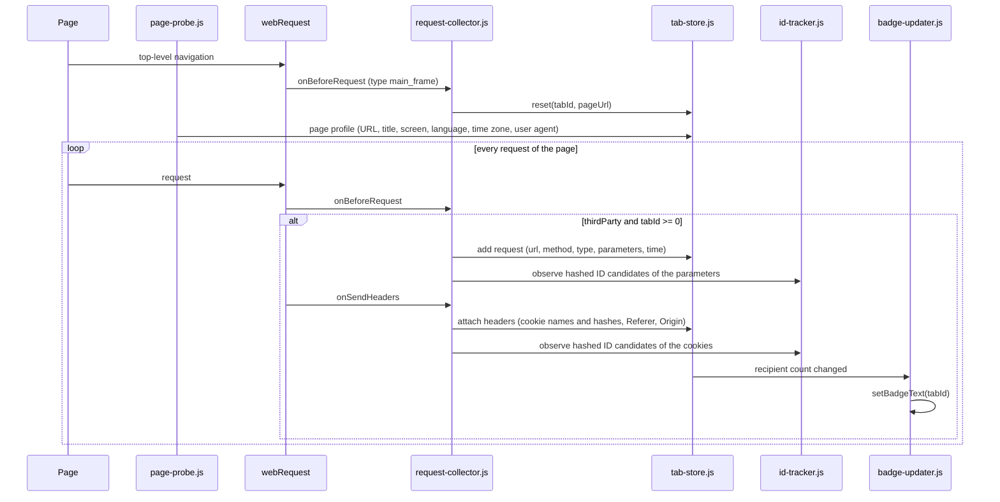
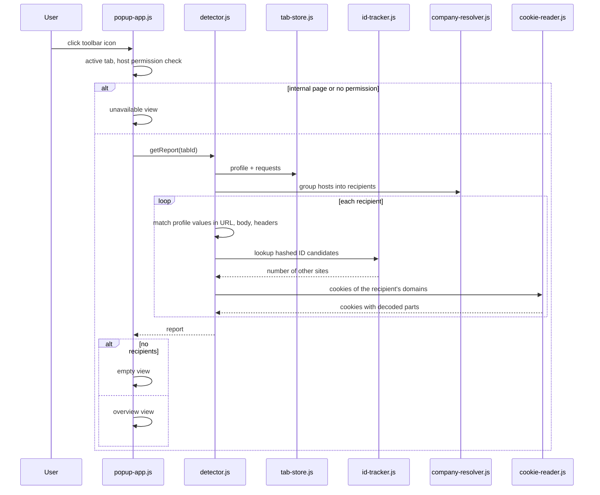
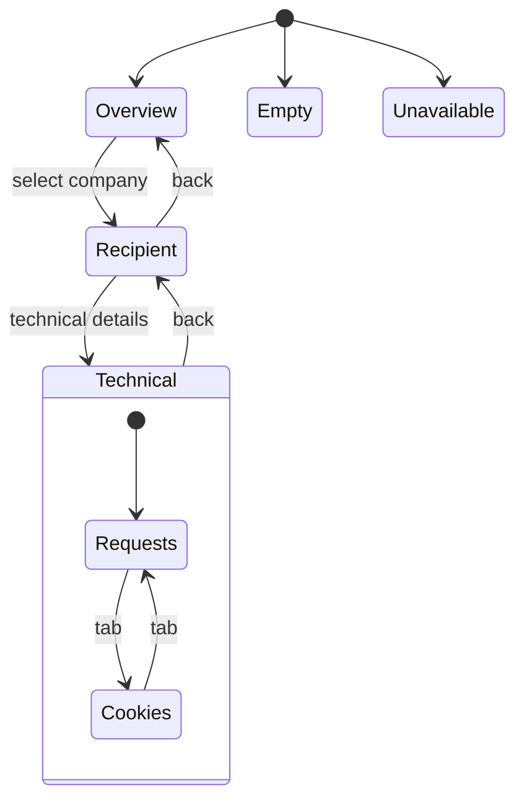

# Data flow

## Collecting

- The page profile can arrive after the first requests. That is fine, because evaluation only happens when the popup opens.
- A profile from a tab without a record (e.g. a page that was already open when the extension was installed) starts a new record from the profile URL.
- ID candidates are recorded while collecting, so sightings on sites where the popup was never opened still count.
- Requests and headers are joined by `requestId`.
- `tabs.onRemoved` deletes the tab entry. A new top-level navigation in the same tab resets it.

## Showing

## Navigation in the popup

