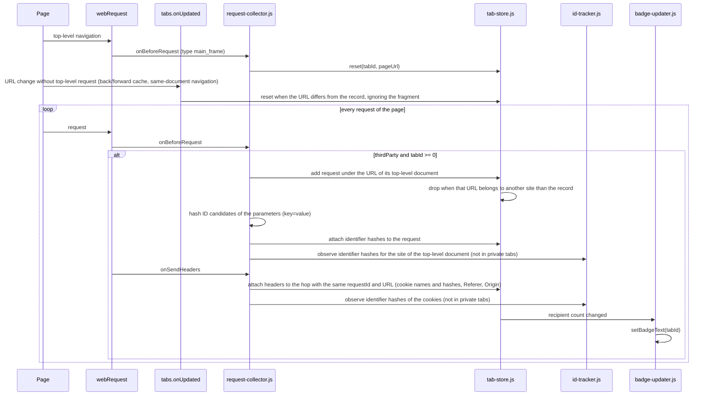
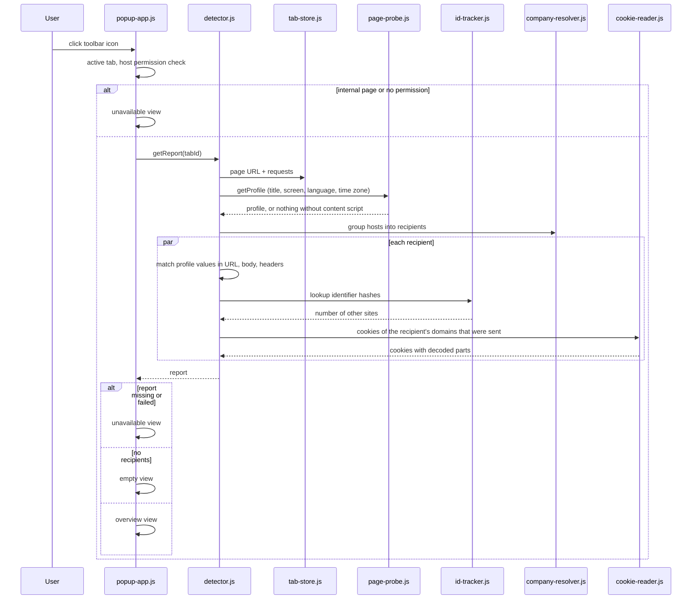
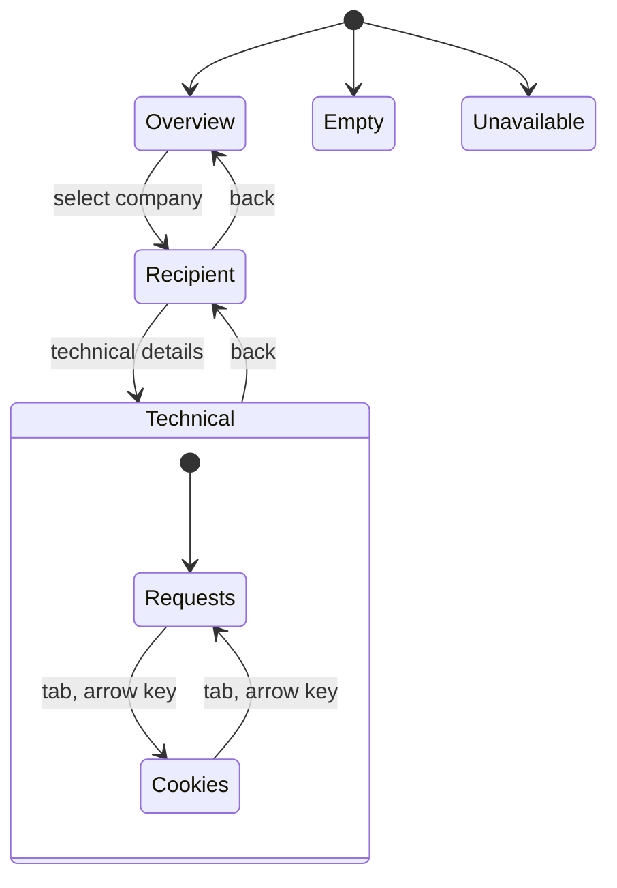

# Data flow

## Collecting

- A request without a tab record (e.g. on a page that was already open when the extension was installed) starts a new record from the URL of its top-level document.
- Requests that arrive after a navigation but were sent by the previous page (e.g. beacons on unload) carry the previous page as their top-level document. They are not added to the new record, but their ID sightings count for the previous site.
- ID candidates are recorded while collecting, so sightings on sites where the popup was never opened still count.
- Requests and headers are joined by `requestId` and URL, because redirects keep the `requestId`.
- A tab keeps the newest 500 requests.
- `tabs.onRemoved` deletes the tab entry.
- `runtime.onSuspend` writes pending tab records and ID sightings before the event page is suspended.

## Showing

## Navigation in the popup

