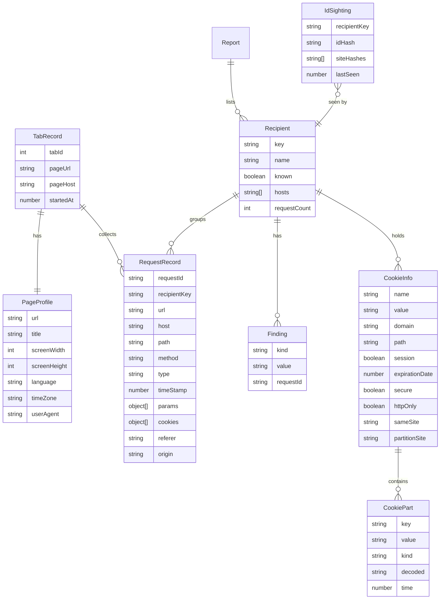

# Data model

## Storage areas

| Area              | Key           | Content        | Lifetime                                       |
|-------------------|---------------|----------------|------------------------------------------------|
| `storage.session` | `tab:<tabId>` | `TabRecord`    | until navigation, tab close or browser restart |
| `storage.local`   | `ids`         | `IdSighting[]` | 30 days per entry, max. 5,000 entries          |

`storage.local` never contains URLs, titles or ID values in plain text, only SHA-256 hashes (first 32 hex characters). An `IdSighting` keeps at most 20 site hashes.

## Entities



## Fields

**`RequestRecord.params`**: `{ key, value, decoded? }` from the query string and the body. Body sources: form data, JSON leaves (key = dotted path), URL-encoded lines, otherwise the whole text under the key `(body)`. Bodies are read up to 64 KB, values cut to 2,048 characters, at most 200 parameters per request. `decoded` holds the decoded text of Base64-looking values.

**`RequestRecord.cookies`**: `{ name, valueHash, candidate }` from the `Cookie` header. Cookie values are never stored, only their hash.

**`RequestRecord.referer` / `origin`**: the header values or `null`.

A tab keeps at most 500 requests.

**`Recipient.cookies`**: `CookieInfo[]`, read live when the report is built and only passed to the popup, never stored. `partitionSite` is the site the cookie is partitioned for, or `null` for unpartitioned cookies.

**`CookiePart.kind`**: `identifier`, `timestamp`, `text` or `null` (see `detection.md`). `time` holds milliseconds for timestamps, `decoded` the readable text for `text`.

**`Recipient.key`**: company id from `companies.json`, otherwise the base domain of the host: the last two labels, or the last three for generic second levels under a two-letter country code (`example.co.uk`). IP addresses stay as they are.

**`Finding.kind`**:

| kind         | UI label (en / de)                                    |
|--------------|-------------------------------------------------------|
| `site`       | the site you are on / auf welcher Seite du bist       |
| `page`       | which page you are viewing / welche Seite du ansiehst |
| `title`      | page title / Seitentitel                              |
| `screen`     | screen size / Bildschirmgröße                         |
| `language`   | language / Sprache                                    |
| `timezone`   | time zone / Zeitzone                                  |
| `useragent`  | browser and system / Browser und System               |
| `cookies`    | cookies                                               |
| `identifier` | recognises you / erkennt dich wieder                  |

**`Report`**: `{ pageHost, recipients[], recognisingCount }`, recipients sorted by number of findings, descending. Recipients whose only finding is `site` count as "only know you are here".

## companies.json

```json
{
  "google": {
    "name": "Google",
    "hosts": ["google-analytics.com", "googletagmanager.com", "doubleclick.net", "googleapis.com", "gstatic.com"]
  }
}
```

A request host belongs to a company when it equals one of its `hosts` or ends with `.` plus one of them.