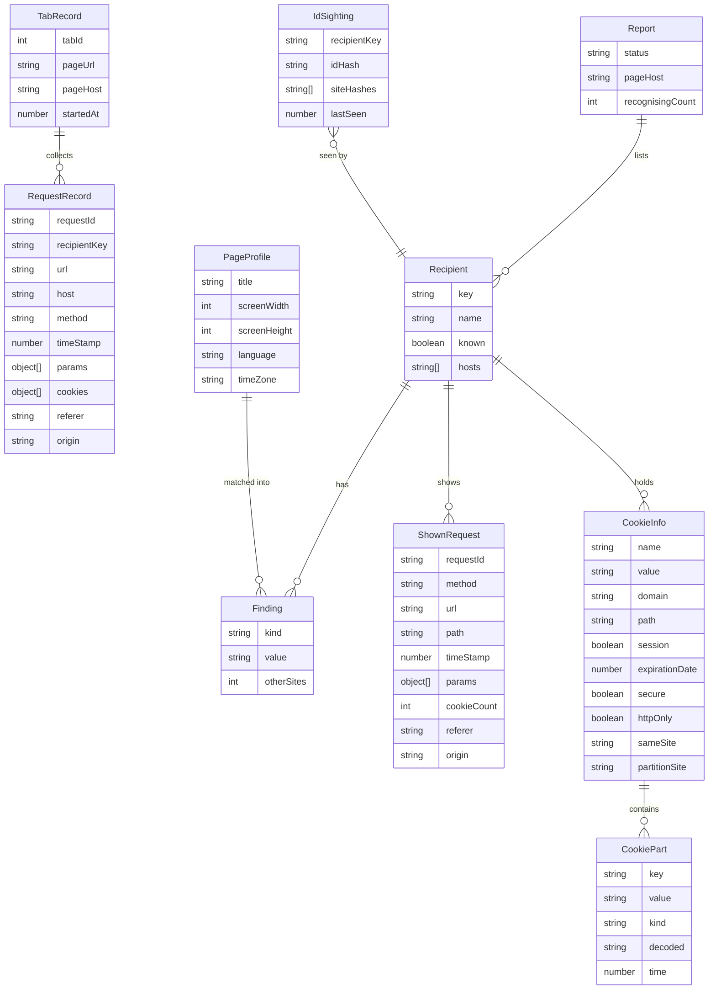

# Data model

## Storage areas

| Area              | Key           | Content                    | Lifetime                                       |
|-------------------|---------------|----------------------------|------------------------------------------------|
| `storage.session` | `tab:<tabId>` | `TabRecord`                | until navigation, tab close or browser restart |
| `storage.local`   | `ids`         | `IdSighting` per entry key | 30 days per entry, max. 5,000 entries          |
| `storage.local`   | `salt`        | 32 random hex characters   | created once per installation                  |

`storage.local` never contains URLs, titles or ID values in plain text. Identifiers are stored as SHA-256 hashes (first 32 hex characters); sites as the first 4 hex characters of the salted SHA-256 hash of their base domain, which is enough to count distinct sites but does not map back to a single site. An `IdSighting` keeps at most 20 site hashes. Sightings are written at most every 10 seconds and on `runtime.onSuspend`; sightings found without a salt are discarded.

`storage.session` is kept in memory. It holds the requests of open tabs with their parameters in plain text, so the popup can show them; the extension writes them at most every 300 ms and logs failed writes (e.g. when the 10 MiB quota is reached).

## Entities



## Fields

**`PageProfile`**: requested from the content script of the tab when the report is built, so title and values are current. Without a content script (e.g. on a page opened before installation) the report is built without it.

**`RequestRecord.params`**: `{ key, value, decoded?, idHashes? }` from the query string and the body. Body sources: form data, JSON leaves (key = dotted path, objects below a depth of 32 as `{…}`/`[…]`), URL-encoded lines, otherwise the whole text under the key `(body)`. Bodies are read up to 64 KB, values cut to 2,048 characters, at most 200 parameters per request. `decoded` holds the decoded text of Base64-looking values. `idHashes` holds `SHA-256(key + "=" + value)` for the value and the decoded value that are ID candidates.

**`RequestRecord.cookies`**: `{ name, valueHash, idHash }` from the `Cookie` header. `valueHash` is `SHA-256(value)`, `idHash` is `SHA-256(name + "=" + value)` for ID candidates, otherwise `null`. Cookie values are never stored.

**`RequestRecord.referer` / `origin`**: the header values or `null`.

A tab keeps the newest 500 requests.

**`ShownRequest`**: a `RequestRecord` prepared for the popup; `path` is path and query of `url`, `params` are `{ key, value, hit }` with `hit` set for parameters that carry a finding.

**`Recipient.cookies`**: `CookieInfo[]`, read live when the report is built and only passed to the popup, never stored. Only cookies that were sent to the recipient on this page are included. `partitionSite` is the site the cookie is partitioned for, or `null` for unpartitioned cookies.

**`CookiePart.kind`**: `identifier`, `timestamp`, `text` or `null` (see `detection.md`). `time` holds milliseconds for timestamps, `decoded` the readable text for `text`.

**`Recipient.key`**: company id from `companies.json`, otherwise the base domain of the host: the last two labels, or the last three for generic second levels under a two-letter country code (`example.co.uk`). IP addresses stay as they are.

**`Finding.kind`**:

| kind         | UI label (en / de)                                        |
|--------------|-----------------------------------------------------------|
| `page`       | which page you're viewing / welche Seite du ansiehst      |
| `title`      | page title / Seitentitel                                  |
| `screen`     | screen size / Bildschirmgröße                             |
| `language`   | language / Sprache                                        |
| `timezone`   | time zone / Zeitzone                                      |
| `cookies`    | cookies                                                   |
| `identifier` | may recognise you / kann dich wiedererkennen              |

`otherSites` is only set for `identifier`.

**`Report`**: `{ status, pageHost, recipients[], recognisingCount }`, `status` is `ok` or `unavailable` (no tab record). Recipients are sorted by number of findings, descending. Recipients without findings count as "only know that you're here and which browser you use".

## companies.json

```json
{
  "google": {
    "name": "Google",
    "hosts": ["google-analytics.com", "googletagmanager.com", "doubleclick.net", "googleapis.com", "gstatic.com"]
  }
}
```

A request host belongs to a company when it equals one of its `hosts` or ends with `.` plus one of them.