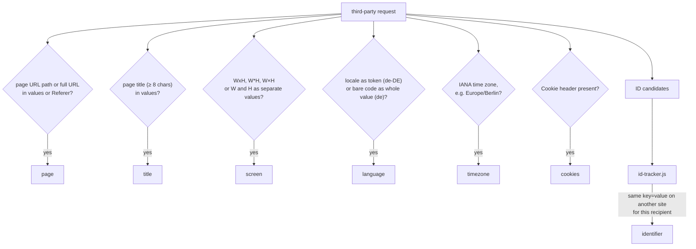

# Detection

`detector.js` works without tracker lists or parameter names. It compares the values from the page profile with what actually leaves the browser.

## Baseline

Every third-party request carries the user's IP address and the `User-Agent` header; most also carry the page origin in `Referer` or `Origin`. Every recipient therefore learns that the user is on this site and which browser and system they use. This baseline is not a finding; the popup states it for recipients without findings ("only know that you're here and which browser you use").

## Search space per request

1. Query parameters of the URL, URL-decoded.
2. Body parameters: form data, JSON leaves, URL-encoded lines or the whole text.
3. Headers: `Referer`, `Origin`, cookie names and value hashes.

Every value is checked as is; values that look like Base64 (length ≥ 16, Base64 alphabet only) and decode to printable text are additionally checked in decoded form.

## Rules

| Finding      | Match                                                                                                                                                                                       |
|--------------|---------------------------------------------------------------------------------------------------------------------------------------------------------------------------------------------|
| `page`       | A value contains the page URL or host plus path, a value equals the path (length ≥ 2), or the `Referer` contains more than the origin.                                                     |
| `title`      | `document.title` with at least 8 characters appears in a value.                                                                                                                             |
| `screen`     | `screen.width` and `screen.height` appear as one value (`1920x1080`, `1920*1080`, `1920×1080`) or as two separate values in the same request.                                               |
| `language`   | `navigator.language` with region (`de-DE`) appears in a value as a whole token, compared case-insensitively, `_` and `-` treated alike. A bare code (`de`) counts only as the whole value. |
| `timezone`   | The IANA name from `Intl.DateTimeFormat().resolvedOptions().timeZone` (4+ characters) appears in a value.                                                                                   |
| `cookies`    | The request carries a `Cookie` header.                                                                                                                                                      |
| `identifier` | See below.                                                                                                                                                                                  |

Without a profile (no content script in the tab), only `page`, `cookies` and `identifier` are evaluated.

## Identifier detection

1. **Candidates:** parameter values (and their decoded form) and cookie values with 10–512 characters, no whitespace, no `/`, no URL scheme, and either at least 8 digits or letters plus at least 4 digits. Rejected are dates (`2024-10-25…`), version numbers (`1.2.3`, `v2.14.3-beta.1`), screen sizes (`1920x1080…`) and language lists (`de-DE,de;q=0.9`).
2. **Hash:** `idHash = SHA-256(key + "=" + value)` with the parameter key or cookie name, so equal values under different keys do not match. The site is stored as the first 4 hex characters of `SHA-256(salt + ":" + baseDomain(pageHost))`.
3. **Sighting:** while collecting, `id-tracker.js` adds the site hash of the request's top-level document to the entry `(recipientKey, idHash)`. Subdomains of one site share the site hash. Private tabs are skipped.
4. **Finding:** if one entry of the recipient contains at least one site hash other than the current site, the recipient gets `identifier`. The UI shows the highest number of other sites and phrases the finding as "may recognise you"; parameters carrying such a value are marked.

Shape rules cannot tell a per-user ID from a value that is the same for every user (e.g. a build hash of a tracking script). Firefox's Total Cookie Protection partitions third-party cookies per site, so cross-site matches come mostly from values passed in URLs or bodies.

Entries older than 30 days are removed; when the limit of 5,000 entries is reached, the oldest is removed first.

## Cookies

`cookie-reader.js` reads the cookies of a recipient when the report is built.

1. **Domains:** the base domains of the hosts the recipient was contacted on.
2. **Query:** `cookies.getAll({ domain, partitionKey: {} })` for each domain returns unpartitioned and partitioned cookies.
3. **Partition filter:** cookies without `partitionKey` and cookies whose `partitionKey.topLevelSite` has the same base domain as the visited site are kept; cookies partitioned for other sites are dropped.
4. **Sent filter:** a cookie is kept when its name and value hash match a cookie from the `Cookie` headers sent to the recipient on this page. For a sent name without such a match (the value changed after sending), the cookies with that name are kept.

The value is split into parts:

| Value                                                                        | Parts                                                       |
|------------------------------------------------------------------------------|-------------------------------------------------------------|
| contains `%XX`                                                               | URL-decoded first                                           |
| JSON object or array                                                         | one part per leaf, key = dotted path                        |
| ISO date or URL                                                              | the whole value as part `1`                                 |
| `key=value` pairs separated by `&`, `:`, `\|` or `;`, each with a value other than only `=` | one part per pair, key = pair key            |
| otherwise separated by `&`, `:` or `\|`                                      | one part per piece, key = position (1, 2, …)                |
| otherwise dot-separated with at least 3 pieces (`GA1.1.123.456`)             | one part per piece                                          |
| otherwise                                                                    | the whole value as part `1`                                 |

Each part (at most 30) gets a kind, checked in this order:

| Kind         | Rule                                                                                                                                    | Shown as          |
|--------------|-----------------------------------------------------------------------------------------------------------------------------------------|-------------------|
| `timestamp`  | ISO date, or 10 digits (seconds) or 13 digits (milliseconds) between 10 years before and 2 years after now                              | date and time     |
| `text`       | Base64 (16+ characters) that decodes to printable text                                                                                  | the readable text |
| `identifier` | ID candidate as above                                                                                                                   | "identifier"      |
| `text`       | two or more words of letters and basic punctuation separated by spaces                                                                  | the readable text |
| `null`       | everything else                                                                                                                         | raw value only    |

The lifetime is `expirationDate − now`. A unit (years, months, days, hours) is used from two whole units on, otherwise the next smaller one, down to minutes; session cookies are shown as "until closed".