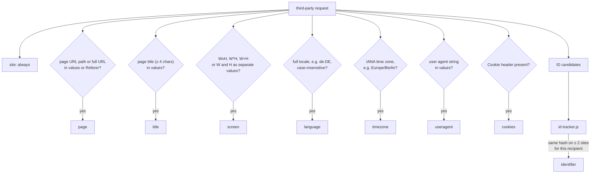

# Detection

`detector.js` works without tracker lists or parameter names. It compares the values from the page profile with what actually leaves the browser.

## Search space per request

1. Query parameters of the URL, URL-decoded.
2. Body parameters: form data, JSON leaves, URL-encoded lines or the whole text.
3. Headers: `Referer`, `Origin`, cookie names and value hashes.

Every value is checked as is; values that look like Base64 (length ≥ 16, Base64 alphabet only) and decode to printable text are additionally checked in decoded form.

## Rules

| Finding      | Match                                                                                                                                                                                |
|--------------|--------------------------------------------------------------------------------------------------------------------------------------------------------------------------------------|
| `site`       | Every recipient receives at least the origin through `Referer`/`Origin` or the IP connection, so it is always set.                                                                   |
| `page`       | A value contains the page URL or host plus path, a value equals the path (length ≥ 2), or the `Referer` contains more than the origin. Without a profile the navigation URL is used. |
| `title`      | `document.title` with at least 4 characters appears in a value.                                                                                                                      |
| `screen`     | `screen.width` and `screen.height` appear as one value (`1920x1080`, `1920*1080`, `1920×1080`) or as two separate values in the same request.                                        |
| `language`   | `navigator.language` appears in a value as a whole token, compared case-insensitively, `_` and `-` treated alike. Two-letter codes alone do not count.                               |
| `timezone`   | The IANA name from `Intl.DateTimeFormat().resolvedOptions().timeZone` (4+ characters) appears in a value.                                                                            |
| `useragent`  | `navigator.userAgent` appears as a value.                                                                                                                                            |
| `cookies`    | The request carries a `Cookie` header.                                                                                                                                               |
| `identifier` | See below.                                                                                                                                                                           |

## Identifier detection

1. **Candidates:** parameter values (and their decoded form) and cookie values with 10–512 characters, at least one digit, no whitespace, no `/` and no URL scheme.
2. **Hash:** `valueHash = SHA-256(value)`, `idHash = SHA-256(recipientKey + ":" + valueHash)`. The site is stored as `SHA-256(pageHost)`.
3. **Sighting:** while collecting, `id-tracker.js` adds the site hash to the entry `(recipientKey, idHash)`.
4. **Finding:** if one entry of the recipient contains at least one site hash other than the current site, the recipient gets `identifier`. The UI shows the highest number of other sites; parameters carrying such an ID are marked.

Entries older than 30 days are removed; when the limit of 5,000 entries is reached, the oldest is removed first.

## Cookies

`cookie-reader.js` reads the cookies of a recipient when the report is built.

1. **Domains:** the base domains of the hosts the recipient was contacted on.
2. **Query:** `cookies.getAll({ domain, partitionKey: {} })` for each domain returns unpartitioned and partitioned cookies.
3. **Filter:** cookies without `partitionKey` and cookies whose `partitionKey.topLevelSite` has the same base domain as the visited site are kept; cookies partitioned for other sites are dropped.

The value is split into parts:

| Value                                                            | Parts                                                                             |
|------------------------------------------------------------------|-----------------------------------------------------------------------------------|
| contains `%XX`                                                   | URL-decoded first                                                                 |
| `key=value` pairs separated by `&`, `:`, `                       | ` or `;`, each with a value other than only `=` one part per pair, key = pair key |
| otherwise separated by `&`, `:` or `                             | `  one part per piece, key = position (1, 2, …)                                   |
| otherwise dot-separated with at least 3 pieces (`GA1.1.123.456`) | one part per piece                                                                |
| otherwise                                                        | the whole value as part `1`                                                       |

Each part (at most 30) gets a kind, checked in this order:

| Kind         | Rule                                                                                                                   | Shown as          |
|--------------|------------------------------------------------------------------------------------------------------------------------|-------------------|
| `timestamp`  | 10 digits (seconds) or 13 digits (milliseconds) between 2000-01-01 and 2100-01-01                                      | date and time     |
| `identifier` | UUID, or 10–512 characters with at least one digit and no whitespace                                                   | "identifier"      |
| `text`       | Base64 (16+ characters) that decodes to printable text, or 4+ characters of letters, spaces and basic punctuation only | the readable text |
| `null`       | everything else                                                                                                        | raw value only    |

The lifetime is `expirationDate − now`. A unit (years, months, days, hours) is used from two whole units on, otherwise the next smaller one, down to minutes; session cookies are shown as "until closed".